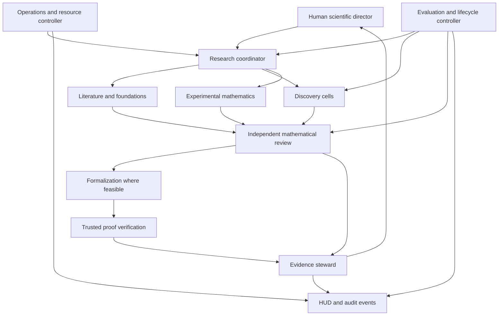

# Mathforge architecture

Revision 2. October 28, 2026. Design proposal with a runnable interactive skill launcher. No autonomous research service is active.

The six subscription design is specified in [six account architecture](six-account-architecture.md), with [account plan](../account-plan.json), [transport evidence](account-transport-evidence.md) and [evaluation cases](six-account-evaluation.md). The public baseline contains no account identities, prices, capacity observations or operator decisions. Runtime implementation follows current project instructions.

## Decision

The director selected Birch and Swinnerton Dyer over Q as the research direction. Use exact arithmetic, explicit elliptic curves, theorem applicability audits, and independent proof review to create a short feedback cycle. This is an infrastructure advantage, not evidence of a greater probability of solving BSD. The comparison and mathematical scope are in research-target.md. The proposed full completion state is defined in solution-contract.md.

The research objective is a defensible new result that advances a meaningful obstruction. A complete solution remains the ambition; neither a time commitment nor a larger swarm guarantees it. The first release must establish that the system can preserve truth and identify useful questions before scaling.

## Scope and authority

Current deliverables are the target comparison, scientific method, reusable skill, command launcher, architecture, contracts, benchmark specification, lifecycle policy, implementation manual, and interactive HUD design. A later accepted implementation supplies durable orchestration, real computation sandboxes, source ingestion, trusted proof verification, authentication, and live telemetry.

The director is the human research director and owns the program and budget. The AI coordinator brings him focused questions when ideas or direction would help, then translates the conversation into explicit hypotheses and bounded tests. It preserves his exact response separately from its interpretation. Independent mathematical referees are a distinct assessment role for major proof claims; ordinary research does not wait for an unfilled director position.

## Capability inventory and owners

| Group | Capabilities and observable result | Sources and state owner | Why grouped |
| :--- | :--- | :--- | :--- |
| Scientific direction | Freeze target, choose bottleneck, assess significance, decide branch continuation | Human decisions and reviewed research map | These decisions concern mathematical value and use of the overall effort |
| Research coordination | Decompose questions, allocate budgets, dispatch ready tasks, integrate reviewed outcomes | Assignment graph and campaign revisions | One owner prevents contradictory priorities and duplicate work |
| Literature and foundations | Retrieve exact statements, map hypotheses, find neighboring results, audit novelty | Source registry and theorem applicability dossiers | These tasks share primary literature and require precise provenance |
| Discovery cells | Develop mechanisms, analogies, examples, reductions and conjectural definitions | Candidate branch artifacts only | These tasks create possibilities and must not certify them |
| Experimental mathematics | Compute exact invariants, construct examples, run falsification tests | Versioned code, inputs and result receipts | Shared computation tools with explicit proof and numeric settings |
| Mathematical review | Reconstruct arguments, find missing hypotheses, refute false claims | Independent signed reviews | Independence conflicts with discovery ownership even when sources overlap |
| Formalization and verification | Encode statements, generate proof terms, audit definitions and replay trusted checks | Candidate proof author and separate trusted verifier | Writing a proof and accepting it require different authority |
| Evidence and memory | Commit accepted revisions, preserve raw artifacts, propagate retractions, prepare handoffs | Evidence steward owns the accepted ledger | One writer avoids contradictory accepted histories |
| Evaluation and lifecycle | Assess workers and referees, detect regressions, recommend replacement and configuration changes | Hidden benchmark and lifecycle controller | Evaluators must not optimize their own grading rules |
| Operations and observation | Enforce budgets, isolation, leases, cancellation, events, recovery and HUD access | Trusted runtime services | Resource and authorization enforcement must operate outside model prompts |

These are responsibilities, not ten permanently running models. Deterministic services own state transitions, budget arithmetic, hashing, and permission checks. The proposed terminal runtime uses six authenticated slots with one active model turn per account. All model calls, including coordinators, reviewers, summaries and evaluators, count toward that limit. The deterministic broker consumes no model slot. Interactive sessions retain their actual host concurrency limits. Time share specialist roles and add a domain coordinator only when a measured coordination bottleneck justifies its cost.

## Organization

Referees share exact claims and sources, but submit initial reviews without seeing the author's confidence rating or another referee's conclusion. Different prompts on the same model are not statistically independent evidence. Count dependence through shared models, source summaries, software engines, and copied argument structure.

## Workflow and handoffs

workflow.json is the design graph. Its nodes specify readiness, ownership, output, and failure route. Budgets bind through each Assignment record in contracts.ts. A future runtime must execute a versioned instance of this graph and render the same version in the live HUD. The current HUD is a concept preview and does not claim execution of this file.

1. Intake freezes the exact claim and authorized scope. Failure to specify a claim routes to clarification of the mathematical statement.
2. Literature and formalization gap audits may run concurrently once the statement is fixed. The planner joins both accepted reports before choosing a branch.
3. Discovery cells produce separate candidate arguments. Computation tasks are dispatched only when their inputs and sandbox are ready. No simultaneous worker edits to the accepted ledger.
4. A candidate enters independent mathematical review and any applicable exact computational check. Failed or inconclusive checks return a precise objection; they do not silently retry forever.
5. Stable, representable lemmas enter formalization. Formalization absence leaves that axis unverified; it does not force a fabricated formal proof or erase a potentially valid informal argument.
6. Promotion requires all checks declared for that claim class. An accepted informal result retains its narrower assurance level. A public claim of solving BSD requires the full intended target, all dependencies, independent expert review, and the appropriate mathematical community assessment.
7. The evidence steward commits the result or objection, updates affected dependencies, and prepares the next human review packet. Evaluation sees the immutable records after outcome finalization.

Every handoff includes source artifact hashes, exact statement revision, assumptions, unresolved objections, negative results, tool versions, and resource receipt. The recipient validates these before using them. A downstream result made with a superseded input becomes stale until revalidated. Every branch join lists the accepted revision it consumed.

## Long duration execution

A skill prompt does not stay alive for thousands of hours. That requires a durable supervisor service, a job queue, a persistent artifact store, provider adapters, and operational recovery. The terminal command delivered here opens an interactive Codex session using the skill. It does not create that service.

The proposed runtime is a small TypeScript coordinator with a local SQLite event and state store, immutable files addressed by SHA256, and separate isolated workers. Use a local React HUD served on loopback. This is a local research tool; there is no need to introduce Supabase or a cloud deployment in the first slice. If later collaboration requires a hosted database, use the shared Supabase client, explicit SQL migrations, RLS, and authorization tests in that separate implementation.

Track wall hours, summed worker hours, GPU hours, provider tokens, monetary cost, and human review hours separately. Six workers running for one hour consume approximately six worker hours and one wall hour, before overhead. Subscription prices do not establish a fixed number of available worker hours. Do not translate tokens into dollars without a pinned applicable price or provider billing receipt. Do not translate local hardware ownership into free compute.

Proposed stages are a 12 worker hour calibration, a 50 worker hour reproduction campaign, a 100 worker hour bounded research pilot, then explicit allocations toward 1,000 or more worker hours. These are ceilings for review, not predictions of mathematical progress. Stop earlier on exhausted budget, invalid environment, or a failed mandatory check. The proposed policy sets additional campaign spending to zero. Actual included usage requires a locally recorded allocation under current human instructions. Actual model bindings, usage eligibility and an effective included only funding boundary are still required before autonomous dispatch. No stage is active merely because it appears here.

Each job has a lease, heartbeat, deadline, idempotency key, cancellation scope, and immutable attempt identity. The queue reserves local time and any known cost bounds before dispatch. Subscription percentages are opaque availability observations; they cannot be reserved as exact token quantities. Each model attempt requires a valid account lease and a qualified included usage path. A timeout creates an unknown outcome requiring reconciliation; it does not automatically duplicate the job. On restart, recover from durable events and reconcile external jobs before scheduling. Pause admits no new work and waits for running effects to reach a recorded boundary. A kill action revokes tool access and reconciles in flight operations.

## Dynamic specialist creation

A worker may propose a specialist with a precise capability gap, role definition, source scope, thinking mode, allowed tools, output schema, finite budget, and admission test. It cannot launch descendants directly or invent a new tool permission. The coordinator submits the proposal to the trusted configuration and resource controller.

The controller checks remaining parent budget, maximum depth, concurrency, configuration schema, required bindings, source permissions, benchmark readiness, and conflict of ownership. A new instance begins in quarantine under a separately qualified definition. It must pass relevant calibration and a handoff comprehension task before receiving substantive research work. Failed admission preserves the artifacts and leaves the instance inactive.

Initial proposed runtime limits are six active model sessions including every coordinator, evaluator and summarizer, at most one active turn per account, hierarchy depth two, and twelve admitted instances per pilot. Extra specialist definitions do not create extra slots or independent budgets. A parent cancellation propagates to descendants. These defaults are adjustable only through an explicit policy revision; they are not evidence that this package enforces them.

## Memory architecture

Preserve the full recoverable artifact record; pass each worker a bounded relevant view. No finite context window can contain every predecessor's experience. The durable store carries the exact sources, while summaries carry links and concise decisions.

Use three layers: immutable originals and computation receipts; a versioned claim and dependency ledger; bounded task context. Begin with direct context and file search. Add indexed retrieval only when measured retrieval failures justify it. Embeddings are a discovery index, never the authority for theorem text or exact formulas.

At natural task boundaries, update the context manifest. Proposed refresh threshold is 60 percent of the recipient's actual context capacity, leaving room for evidence retrieval and proof development. Measure capacity when possible; label estimates. A summary preserves all exact statement references, definitions, assumptions, rejected routes, objections, and pending decisions. Validate by reconstructing the next assignment from the candidate summary and retrieving the original evidence before replacing the working context.

Retirement is a change of active instance, not deletion. Preserve lineage, model and prompt revisions, assignments, evidence, objections, and successor admission results. The new instance must explain the current target, identify a known failed route, and recover the exact source for a critical premise. The director may direct a staffing change without proving measured degradation; record it as an operator decision and preserve any unresolved objection. Do not retain private hidden reasoning as a requirement; retain explicit mathematical arguments and observable decisions.

## Security and trust

Literature ingestion processes untrusted external content. Research workers need code execution, but do not need host credentials or broad outbound access. Remove the dangerous combination by keeping credentials in the controller, using a separate allowlisted retrieval service, and running generated code in a resource limited environment with no host home mount and no unrestricted network. An ordinary Python subprocess is not a qualifying isolation boundary.

Inspect actual Vercel, E2B, Daytona, or local VM capabilities during implementation. Choose after measuring mathematics package compatibility, startup, warm execution, persistence, cost, and network controls. No provider is bound now. There is no fallback to unrestricted host execution when the configured sandbox is unavailable.

Workers cannot edit the accepted ledger, hidden benchmarks, trusted checker, target statement, spending policy, or supervisor implementation. Changes are proposals reviewed and tested separately. External text cannot alter tool privileges. Persist raw source and derived summary trust labels through handoffs. Render source text and JSON as inert text in the HUD.

## Evaluation and success

The primary scientific outcome is independently accepted progress on a director selected obligation. Correctness, useful falsification, replication, hypothesis accuracy, reviewer sensitivity, and handoff fidelity are supporting measures. Novelty and relevance require expert assessment and explicit uncertainty. There is no scalar score for genius.

Use verification-and-lifecycle.md for the policy and evals/acceptanceCases.json for candidate benchmark cases. These cases are specifications, not measured model scores. Freeze the benchmark and trusted grader before comparing configurations. Preserve a protected set outside worker access. Evaluate reviewers with planted errors and valid subtle arguments to measure both false acceptance and false rejection.

No result can pass because the average score is high when a mandatory safety or proof check fails. A slow open problem can remain worth pursuing. Diagnose task difficulty, tool failure, retrieval failure, context damage, or a false strategy before replacing its worker.

## HUD

The HUD answers five questions: what exact question is being pursued; which teams are doing what; what is actually known; why was a branch or agent changed; and where does human judgment matter next.

Required views are the research map and proof dependency graph, parallel execution timeline, exact captured input and output inspector, source and assumption ledger, claim review queue, benchmark comparison, agent lineage, memory handoff audit, resource budget, and mathematician review packets. Show synthetic, disconnected, stale, missing, conditional, refuted, and verified states distinctly. Never show a progress bar for percentage of BSD solved.

## Coverage and omissions review

The inventory covers discovery, creative exploration, rigorous verification, useful failed results, human direction, dynamic staffing, replacement, full artifact retention, bounded context, tooling, lifecycle evaluation, long duration operations, and visibility. Bind the actual director in local campaign records. Runtime dependencies still unbound are the durable controller, actual inference provider, cost cap, computation sandbox, mathematics toolchain, trusted verification gateway, benchmark labels, and live event adapter. Independent expert assessment is also required before final solution acceptance.

Walkthrough A: a valid auxiliary lemma goes through exact statement review, independent proof review, optional formalization, appropriate verification, and ledger commit. Walkthrough B: a floating point zero claim is held, the worker gets a precise certification request, and downstream use remains blocked. Walkthrough C: a premise is retracted after publication in the local ledger; the steward invalidates dependent claims and active jobs, preserves history, and requires new input revisions. These cases are included in the acceptance specification.

Concrete architecture and execution scope must be reviewable before dependent implementation; current explicit user instructions determine whether that work is authorized. This package completes the reviewable design and launcher first. A response accepting this architecture may authorize the implementation slice without repeating permission for ordinary steps. Long duration research spending remains a separate finite allocation.
