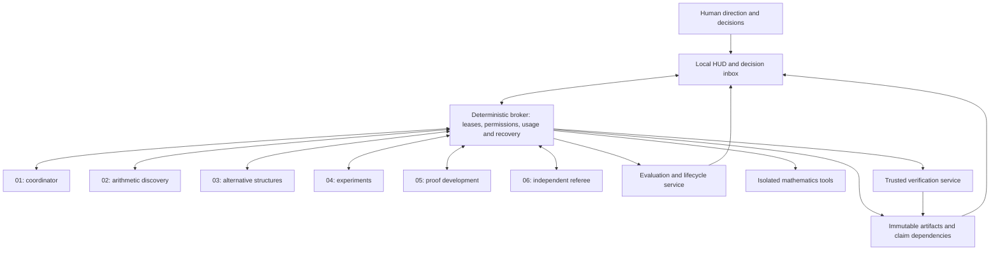

# Six account research architecture

Revision 2. October 28, 2026. Design only. This public baseline contains the design and interactive launcher; implementation authority comes from current project instructions.

## Allocation

Use six separately authenticated Codex worker slots, one durable local broker, and one evidence store. The broker is ordinary software. Scientific planning consumes slot 01; the broker does not need a seventh model. The director remains the human director. The selected mathematical target and [solution contract](solution-contract.md) define the proposed scientific scope.

The public [account plan](../account-plan.json) contains six unconfigured slots. Enter private plan information and campaign decisions outside version control. Actual plans, model access, usage windows, account independence and current remaining allowance are unknown.

| Slot | Monthly price | Initial responsibility | Required output |
| :--- | :--- | :--- | :--- |
| 01 | Unknown | Scientific coordination, literature triage, dialogue with the director | A precise obstruction, ready assignments, source map and focused decision packets |
| 02 | Unknown | Arithmetic discovery | Candidate lemmas and reductions with exact hypotheses and target relevance |
| 03 | Unknown | Alternative structures and creative exploration | A different approach, testable definitions or analogies, and a cheapest discriminating test |
| 04 | Unknown | Experimental mathematics and tooling | Reproducible computations, falsification attempts, explicit numerical limits and tool receipts |
| 05 | Unknown | Sustained proof development and formalization | Complete arguments for bounded lemmas, formalization gaps and candidate proof artifacts |
| 06 | Unknown | Independent skeptical review | An initially blind review, precise objections, attempted counterexamples and review evidence |

Slots 05 and 06 provisionally receive sustained proof work and review. Assign actual capacity after enrollment. Price does not establish mathematical ability. Role admission depends on available models and matched evaluations. Reallocate roles after measuring the bottleneck. A useful branch can receive several consecutive assignments without fabricating progress to keep its seat.

These are six execution slots, not six permanent personalities. Many specialist definitions may exist; only six model turns may be active globally in the proposed runtime, initially at most one per authenticated account. Every evaluator, judge, summarizer and child model consumes a slot. Interactive collaboration obeys the actual host limit; this design does not change it.

## System map

Models propose assignments, specialist definitions, hypotheses and staffing changes. The broker validates them against the accepted policy. The evidence service alone changes accepted claim state after required receipts exist. Neither a coordinating model nor an account with more allowance gains authority to waive a mathematical check.

Keep the first runtime local: TypeScript, SQLite, immutable artifact files and a React HUD on loopback with authenticated operator access. Math computation and trusted proof checking require qualified isolation. Local hardware and EXO remain optional future capabilities until inspected and measured.

## Native Codex account connections

Use a dedicated native Codex app server process for each slot with stdio transport. Give each process its own private `CODEX_HOME`, owned by the controller, and one serialized process owner. Use Codex managed ChatGPT sign in and refresh. The broker exchanges protocol messages with those processes, not terminal keystrokes or copied credentials. These are supported building blocks; their six account integration has not been exercised. [Official app server documentation](https://learn.chatgpt.com/docs/app-server)

Proposed private state root is `<private-state-root>/mathforge/`. Use `accounts/01/codex` through `accounts/06/codex` beneath it. These directories do not exist as a result of this revision. Keep them outside the package, research workspace, output archive and shared evidence store. Each future child receives its own environment; do not alter the user's default Codex home.

For the first qualified setup, use the documented file credential store explicitly if managed configuration permits it. This makes each credential source unambiguous. Protect directories and files with owner only access and exclude them from artifacts and logs. Keyring isolation across six homes is not established by this task. Separate directories under one OS user are not an access control boundary; generated tools need an enforced sandbox denying every account credential root, hidden evaluation fixtures and controller internals. [Official authentication documentation](https://learn.chatgpt.com/docs/auth)

Future enrollment is manual first:

1. Pin the CLI build and generate its protocol schema. Start one controlled process and verify its `initialize` response points to the intended home.
2. Have the director complete the native login flow for the selected account. Enroll accounts sequentially. Do not script passwords, copy tokens, scrape credentials or assume the browser selected the intended account.
3. Read the authenticated account and account usage through the protocol. Bind privacy protected identity evidence, actual plan, model inventory and connection generation to the slot. Reject accidental duplicate identity. Unknown identity requires explicit resolution before the slot is counted as distinct.
4. Check the supported usage and funding controls. Qualify the isolation profile with disposable canaries, then run one bounded permitted control assignment. Enroll the remaining slots only after this path works.
5. Readiness is a durable receipt with missing bindings recorded. A UI label or a successful login alone cannot mark a slot ready for autonomous research.

The installed CLI schema has `account/read` with account type, nullable email and plan type. Its `account/rateLimits/read` response also has nullable `accountId` and `ordinaryUsageAllowed`. Validate identity against the current connection and reject stale or conflicting observations. A missing ID is unknown. A provider metering `limitId` such as `codex` is not an account identity or a globally unique pool identity. See the exact local evidence and compatibility limits in [account transport evidence](account-transport-evidence.md).

Pin a connection generation to every attempt. On reauthentication or identity change, stop new dispatch, reconcile active work, revalidate identity and record a new generation. A replacement worker receives artifact references and a new lease; it never inherits another account's authentication.

## Usage and spending

Record the operator's actual capacity authorization in the local campaign. Do useful admitted work while capacity exists; avoid activity whose only purpose is exhausting a plan. This public template itself authorizes neither a runtime build nor a research allocation.

Keep subscription fees, additional model charges, compute expenses, worker hours and wall hours separate. Six active workers for one hour are about six worker hours. That arithmetic does not predict how long six subscriptions will run. Usage is workload dependent, may share limits with other work, and cannot be converted into guaranteed hours from the reported subscription prices. [Official pricing documentation](https://learn.chatgpt.com/docs/pricing)

Dispatch requires current identity, allowed capabilities, a finite assignment, a free slot, a qualified included usage path and fresh eligibility evidence. Retain every actual limit window and its timestamp. Prefer the multi bucket usage response when present. Respect an explicit provider denial even if displayed percentages appear healthy. Do not infer recovery merely because a reset timestamp passed. Unknown eligibility holds unattended dispatch.

Maintain separate records for slot, account, metering bucket and confirmed shared pool. Never add percentages across accounts or across short and long windows. Unknown pool relationships stay unknown; equal bucket names or similar usage values do not prove a common pool, and different logins do not prove independent capacity. Reconcile the user's other activity as well as local reservations.

Additional paid usage is not authorized. API key fallback, purchasing credits, automatic recharge, subscription upgrades and redeeming usage resets are outside this authorization. Native ChatGPT authentication alone does not prove calls cannot consume credits. A verified provider funding boundary or equivalent tested exclusion of paid usage is required before an account enters autonomous included only operation. A local percentage threshold cannot guarantee that the final request stays within included allowance. Existing credits and account controls are uninspected.

If a slot reaches its limit, preserve its checkpoint, release its lease after reconciliation, and queue the next assignment on another eligible slot when appropriate. Maintain global task budgets and contribution history. If no eligible slot exists, wait until eligibility can be checked again. A process restart does not replenish capacity. Do not create an automatic purchase path to keep all six slots busy.

## Communication and scientific rhythm

Communication is artifact based and purposeful. Each broker envelope identifies campaign, assignment revision, sender instance, recipient role, artifact hashes, claim revision, source trust, requested action, visibility policy, deadline and idempotency key. The controller authenticates the sender from the live lease. Model supplied sender fields cannot establish authority. Mathematical discussion is stored; credentials and hidden chain of thought are not part of a handoff.

Use this cycle for a bounded obligation:

1. Slot 01 defines the question and relevance to a BSD obstruction. Slots 02 and 03 first produce separate approaches without seeing each other's preferred conclusion.
2. Slot 04 runs the smallest qualified test that could distinguish or falsify them. Failed hypotheses become retained evidence. Numerical results keep their numerical status.
3. Slot 05 reconstructs the strongest surviving argument with every dependency explicit. It may propose a specialist for a specific missing capability; the specialist uses an existing slot under the same budget.
4. Slot 06 receives the exact proof and necessary evidence with other verdicts and author confidence withheld. Its initial report is committed before discussion. Later dialogue can correct the report while preserving that first judgment.
5. Qualified verification runs outside the author environment. The evidence service applies the existing [solution contract](solution-contract.md), including semantic fidelity and any external human review obligations. Agent agreement does not establish a theorem.
6. Slot 01 prepares the next test or a focused conversation with the director. Ask about a meaningful branch choice, new structure or persistent obstruction; preserve his words separately from the system's interpretation and the next test.

Synchronization happens at evidence boundaries, not through continuous all to all chat. In parallel, other ready tasks can progress without waiting for a whole team meeting. Prioritize proof objections and useful replication before starting more speculative branches. Preserve the initial 60 percent targeted research, 25 percent reproduction and tooling, and 15 percent speculation allocation within discovery effort; verification has its own reserved capacity.

Account 06 can time share independent referee and evaluation roles through distinct admitted contexts. Hidden benchmark answers remain outside research and referee contexts. If an evaluator itself uses a model, its call counts within the same six slots. If a second independent review is needed, use another uncontaminated slot or a sequential fresh context with exposure checked. Different accounts using the same model do not establish statistical independence.

## Replacement and memory

Keep account, role definition, agent instance and mathematical branch as separate identities. An allowance event does not mean the mathematician failed. A difficult unresolved conjecture is not evidence of cognitive decline. Diagnose wrong hypotheses, tool failures, context damage and task difficulty before recommending replacement.

Retain the existing [benchmark and lifecycle policy](verification-and-lifecycle.md). Evaluate accuracy, reviewer false acceptance and rejection, useful falsification, citation fidelity, task matched productivity and handoff comprehension. Changing a role or prompt requires a recorded definition revision and admission evidence. New definitions begin with narrow capability and cannot edit their own grader.

Before replacing an instance, reconcile unfinished calls and record the exact target, source hashes, accepted and rejected results, unresolved objections, dependency revisions, context index and remaining budget. A successor must retrieve a critical premise, explain a failed route and reconstruct the next assignment. Full durable evidence survives; context receives a bounded relevant selection. Authorship and prior exposure survive every reset.

## Delivery and acceptance

The revised package supplies the six slot plan, typed design contracts, independent transport research, 38 account integrity case specifications, and a revised HUD. The public HUD shows unconfigured pricing, six disconnected slots and unknown live values. Synthetic research demonstrations remain visibly separate.

Implementation authority follows current project instructions and locally recorded scope. The [build manual](build-manual.md) defines concrete files and gates: operator screen, deterministic broker and isolated account transport, mathematics verification, then bounded calibration. The interactive `mathforge` launcher remains unchanged. No six account daemon, login helper or live HUD is currently implemented.

Future qualification must prove actual account separation, correct identity attribution, included usage controls, full model call accounting, durable recovery, blind review access and legitimate successful work. [Six account evaluation](six-account-evaluation.md) supplies the failure cases. Passing package checks cannot satisfy these runtime obligations or establish mathematical progress.
