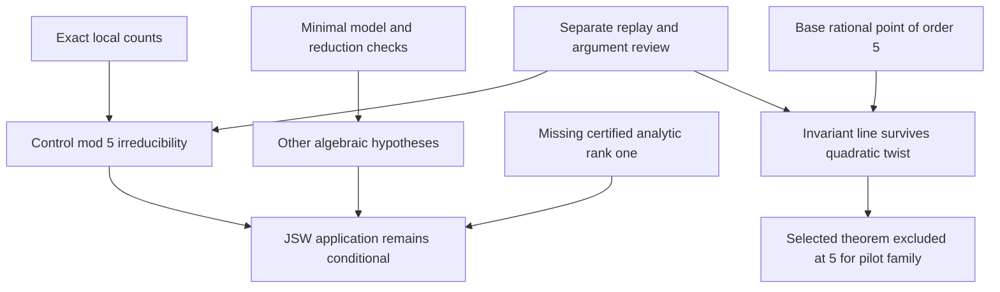

# Run 001: first live BSD calibration

Started October 28, 2026 at 20:53:26 UTC. Baseline repository commit: `1b538e4e3ea875fa21e6a79e7a5d89db2b840899`.

**Question:** can the team produce a reproducible theorem applicability dossier for the analytic rank one control curve at the prime 5, with exact arithmetic witnesses, explicit missing obligations and a separate review?

**Scope:** one source audit, exact finite field counts for three specified curve models at good primes up to 43, an argument connecting relevant witnesses to theorem hypotheses, and a review. The source worker has a 12 minute process limit. No persistent service, new account login, external correspondence, additional purchase or long research allocation is part of this run. The director's [shared team protocol](run-001-team-protocol.md) governs collaboration.

**Target relationship:** this calibrates the use of a known theorem about a prime part of the leading coefficient formula. It cannot establish universal BSD or a new theorem. Rank equality, finiteness and the full coefficient formula retain separate statuses. Analytic rank must have its own evidence; a database entry or approximate numerical value is not a proof receipt.

**Capabilities checked:** Codex CLI is installed and reported a ChatGPT login. Python and Git are available. Lean, Lake, Sage and PARI were not found on the inspected PATH. The source worker was started as an actual `codex exec` process using the existing configured account and model. A separate arithmetic agent performs the bounded computation. This is manual coordination with real workers, not the proposed persistent broker or six connected accounts.

**Initial status:** research active. Completion, verification results, revisions and resource measurements will be recorded below when available. Raw process transcripts stay in ignored local scratch; public records contain the actual findings and concise receipts.

## Completed outcome

Research and review finished at 21:03:49 UTC, October 28, 2026. Elapsed wall time from the recorded start was 623 seconds. This includes coordination and retrieval, not measured active model compute. Publishing and CI occur after this scientific work interval. No continuing worker or background research service remains active from this run.

The [source worker](../sources/run-001-jsw-audit.md) inspected both the original and published Jetchev, Skinner and Wan statement and recorded its exact locator, Theorem 1.2.1. The [arithmetic worker](../experiments/run-001-local-counts/README.md) produced 40 exact good prime comparisons on three supplied models. A [separate referee](../reviews/run-001-referee.md) reconstructed all 40 with a different implementation and checked the standard mathematical bridges. The coordinator combined these in the [representation finding](../findings/run-001-representation-obstruction.md).

The control curve has irreducible mod 5 representation, certified here by a short argument from seven points over F3 and the standard Frobenius polynomial identity. The pilot base has a rational point of order 5. Scalar twisting preserves its invariant line, so every rational quadratic twist of this base has reducible mod 5 representation. Consequently the selected theorem does not apply at 5 anywhere in the proposed pilot twist family. This is an explicit excluded route, not a BSD counterexample or a novel theorem.

The control's remaining missing hypothesis is certified analytic rank exactly one. No unconditional application of the prime part theorem was claimed. The theorem's exact scope, period convention and torsion denominator were kept separate from the universal BSD target. The referee also noted that changing the pilot's prime alone does not establish semistability for its twists.

## Collaboration and checking

Workers shared source locators, arithmetic witnesses and objections through the common files and coordinator messages. A reviewer correction to the Sutherland page locator was incorporated before the final artifact hashes were recorded. The referee independently reconstructed the mathematical content rather than voting on agreement.

Three openly supplied invalid inferences were rejected: a failed finite point search proves rank zero; numerical rounding proves exact L function vanishing; and rational 5 torsion persists on every quadratic twist. The last rejection includes an explicit negative twist with only three points modulo 3, excluding rational 5 torsion. These are transparent calibration probes, not protected benchmark scores or evidence of general superiority over an individual mathematician. No agent retirement decision is justified by this small sample.

The review supports the stated arguments at separate model review assurance. No Lean check, qualified external human review or trusted acceptance service was used. Shared source, model and interpreter dependencies remain recorded. Hashes identify exact reviewed artifacts; they do not establish the truth of an arbitrary statement.

## Receipts and next assignment

The [source process receipt](run-001-source-process.json) records a real Codex process that exited 0 after 330.732 wall seconds without a timeout. The arithmetic execution and separate replay receipts preserve their actual versions, execution durations, inputs and hashes. Monetary cost, aggregate tokens and active model compute time are not measured here. No new subscription, API purchase or account enrollment was performed.

Resume from [STATE.md](../STATE.md). The next bounded task is a certified analytic rank dossier for `[0,0,1,-1,0]`, with the exact analytic premise required by the audited theorem. Preserve a failure or missing certification capability as such. The runtime project still needs a durable worker coordinator, live evidence display, restart recovery and qualified account isolation before sustained six slot operation.

